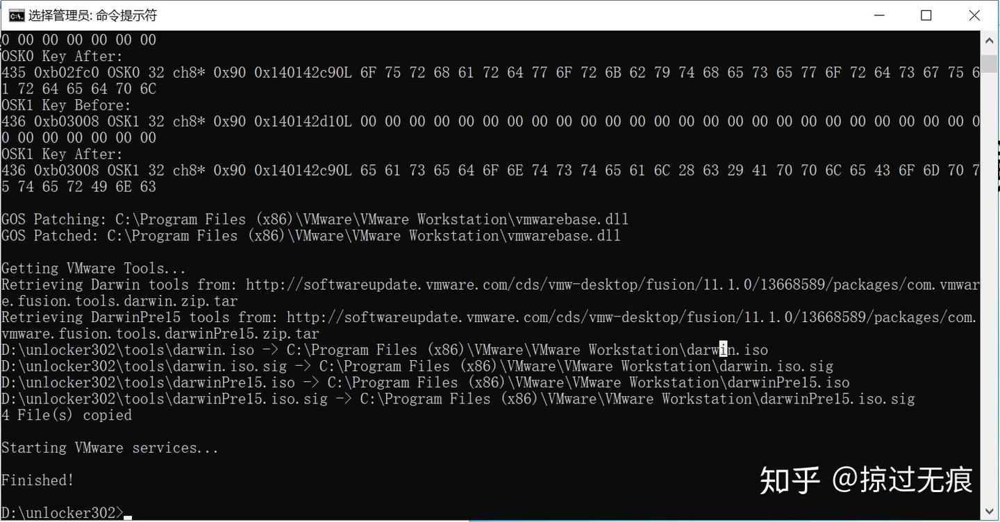
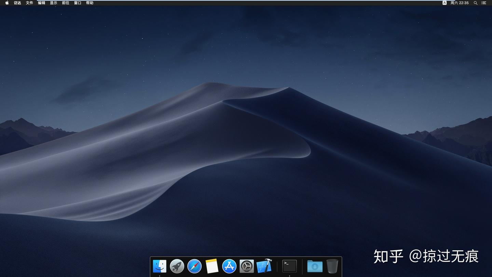

# 一. 安装前

## 1. 安装环境

- Windows 10
- VMware Pro 14

## 2. 系统硬件配置

- 内存推荐 16G 以上
- 硬盘预留 40G 以上
- CPU推荐 i5 8th以上

## 3. 安装 MacOS 必备包

- VMware Pro 14

**填壹号坑**: 一定要使用 Pro 版本, Player 版本安装的黑苹果不稳定, 经常会自动重启.  
[VMware pro 14 官网下载地址](https://my.vmware.com/cn/web/vmware/info/slug/desktop_end_user_computing/vmware_workstation_pro/14_0)

- MacOS 系统镜像 (6G左右大小)

**cdr** \[推荐\] 格式, 懒人安装包, 因为易装, 麻烦少.

**填贰号坑**: 试过使用神马HFSExplorer将dmg 转cdr的工具, 结果那工具不行, 老是弹出 error 框. 于是就搜索下载别人发的 cdr包进行安装

**dmg** 格式, 原始镜像, 没有试过这个格式的安装, 不了解该这么填这个坑  
**ISO** 格式, 可以使用 UltraISO 工具将 dmg 格式转为 iso 格式, 然后进行安装, 但是中途遇到了 boot 问题, 于是换用cdr 进行安装.

- MacOS Unlocker for VMware, 简称 Unlocker

能够让 VMware 选择 Mac 系统进行安装的**补丁**  
[Unlocker 在 github 的下载地址](https://github.com/DrDonk/unlocker/releases)  
windows 选择第一个 unlocker302.**zip** 进行下载即可

# 二. 安装中

## 1. 安装 VMware Pro 14, 并注册

此步骤网络上的教程挺多, 安装也不复杂, 过程很顺利.  
注册看个人了, 惯用的方式是网上搜索密钥进行注册, 密钥如: ZC5XK-A6E0M-080XQ-04ZZG-YF08D, ZY5H0-D3Y8K-M89EZ-AYPEG-MYUA8

## 2. 安装 Unlocker

### 2.1 使用超级管理员运行 cmd.

在任务栏的搜索框中, 搜索 cmd, 然后**右击**使用管理员运行 cmd  
**解压**已经下载的 unlocker, 并在刚才打开的终端上, cd 到解压的目录之下  
然后终端**执行** `win-install.cmd`

### 2.2 终端报错了

看到终端有 Successfully, Finished 等词时, 先不要高兴太早, 因为那整句话是**否定**的.

报错内容有

- `***.***` 文件权限问题

哪一个文件的权限出了问题, 就找到它, 然后给它添加权限就可以了.  
操作步骤: 1)鼠标右击选择属性 --> 2)选择安全选项卡 --> 3)点击编辑 --> 4)选择 Everyone (组或用户名) --> 5)允许完全控制.

- 没有找到 `drawn*.*` 文件

看了一下终端是访问了 `http://***` 链接之后才报的错误, 认为是访问超时了, 结果重试执行 `win-install.cmd` 了几次都不行, 然后打开浏览器进行访问该链接, 结果浏览器返回 not found. 一脸懵逼, 坑爹啊这是  
**填叁号坑**:  
解决**办法** - 修改源码后, 重新编译打包 exe  
修改**文件**: `gettools.py`, 修改后的完整代码放在最后, 有中文注释.  
**思路**: 访问问题, 那就修改访问的链接; 由于VMware 服务器识别 UA, 所以伪装 UA, 然后将修改的代码打包成 exe 可执行文件.  
**打包**exe: 需要 python3.x 环境, 依赖包: requests, PyInstaller; 打包命令 `pyinstaller -F gettools.py`  
**替换**之前解压的 `gettools.exe` 文件: 打包 exe 后, 会生成 dist 文件夹, 找到里面的 exe 文件, 替换 unlocker 文件夹中的 `gettools.exe` 文件

补充

安装依赖包的命令: `pip3 install requests PyInstaller -i https://pypi.douban.com/simple`; 打包exe 前, 需要打开终端并切换到 `gettools.py` 文件所在目录下再执行打包命令.

而正确的终端输出应该是



### 2.3 安装 mac

1. 运行 VMware 并创建新的虚拟机
2. CD/DVD 处选择 cdr 文件, 然后启动虚拟系统
3. 虚拟系统启动, 虚拟机报错问题: 打开安装虚拟系统的目录中的 `***.vmx` 文本文件, 添加 `smc.version = "0"` 配置项
4. 安装虚拟系统过程中遇到的安装盘新问题  
   解决步骤: 1)选择实用工具/磁盘工具 --> 2)然后选择 VMware 硬盘 --> 3)输入一个英文名称 --> 4)点击抹掉按钮 --> 5)点击安装系统进行安装.
5. 安装 VMTools

关机mac, 在 CD/DVD 处选择 VMware Pro 安装目录下的 `darwin.iso` (Unlocker 生成的文件), 我的 VMware Pro 安装目录是 `C:\Program Files (x86)\VMware\VMware Workstation`  
开机, 打开桌面上的光盘进行安装

### 2.4 屏幕大小, 分辨率问题

在VMware里装 VMTools 后发现全屏时的分辨率是 950 (HiDPI) 的, 在设置/显示器/缩放中, 点击1920 的死活切换不了.  
但是你通过以上的程序, Unlocker 补丁正确的打好了, 那么只要你点击 VMware Pro 的全屏按钮, 就可以将 Mac 系统桌面全屏.

效果图



安装效果图

## gettools.py完整代码

```python
from __future__ import print_function

import os
import shutil
import sys
import tarfile
import zipfile

# 添加处, 方便伪装 User-Agent
import requests


# 添加处
def download_drawn(url, path):
    headers = {
        'User-Agent': 'Mozilla/5.0 (Windows NT 10.0; Win64; x64) AppleWebKit/537.36 (KHTML, like Gecko) Chrome/76.0.3809.132 Safari/537.36',
    }
    resp = requests.get(url, headers=headers, timeout=180)
    with open(path, "wb") as fp:
        fp.write(resp.content)


def convertpath(path):
    # OS path separator replacement funciton
    return path.replace(os.path.sep, '\\')  # 修改处


def main():
    # Check minimal Python version is 2.7
    if sys.version_info < (2, 7):
        sys.stderr.write('You need Python 2.7 or later\n')
        sys.exit(1)

    # Setup url and file paths
    url = 'http://softwareupdate.vmware.com/cds/vmw-desktop/fusion/'
    dest = os.path.dirname(os.path.abspath(__file__))

    # Re-create the tools folder
    shutil.rmtree(dest + '/tools', True)
    os.mkdir(dest + '/tools')

    # 删改处
    urlpost15 = url + '11.1.0/13668589' + '/packages/com.vmware.fusion.tools.darwin.zip.tar'
    urlpre15 = url + '11.1.0/13668589' + '/packages/com.vmware.fusion.tools.darwinPre15.zip.tar'

    # Download the darwin.iso tgz file
    print('Retrieving Darwin tools from: ' + urlpost15)
    # 修改处
    download_drawn(urlpost15, convertpath(dest + '/tools/com.vmware.fusion.tools.darwin.zip.tar'))

    # Extract the tar to zip
    tar = tarfile.open(convertpath(dest + '/tools/com.vmware.fusion.tools.darwin.zip.tar'), 'r')
    tar.extract('com.vmware.fusion.tools.darwin.zip', path=convertpath(dest + '/tools/'))
    tar.close()

    # Extract the iso and sig files from zip
    cdszip = zipfile.ZipFile(convertpath(dest + '/tools/com.vmware.fusion.tools.darwin.zip'), 'r')
    cdszip.extract('payload/darwin.iso', path=convertpath(dest + '/tools/'))
    cdszip.extract('payload/darwin.iso.sig', path=convertpath(dest + '/tools/'))
    cdszip.close()

    # Move the iso and sig files to tools folder
    shutil.move(convertpath(dest + '/tools/payload/darwin.iso'), convertpath(dest + '/tools/darwin.iso'))
    shutil.move(convertpath(dest + '/tools/payload/darwin.iso.sig'), convertpath(dest + '/tools/darwin.iso.sig'))

    # Cleanup working files and folders
    shutil.rmtree(convertpath(dest + '/tools/payload'), True)
    os.remove(convertpath(dest + '/tools/com.vmware.fusion.tools.darwin.zip.tar'))
    os.remove(convertpath(dest + '/tools/com.vmware.fusion.tools.darwin.zip'))

    # Download the darwinPre15.iso tgz file
    print('Retrieving DarwinPre15 tools from: ' + urlpre15)
    # 修改处
    download_drawn(urlpre15, convertpath(dest + '/tools/com.vmware.fusion.tools.darwinPre15.zip.tar'))

    # Extract the tar to zip
    tar = tarfile.open(convertpath(dest + '/tools/com.vmware.fusion.tools.darwinPre15.zip.tar'), 'r')
    tar.extract('com.vmware.fusion.tools.darwinPre15.zip', path=convertpath(dest + '/tools/'))
    tar.close()

    # Extract the iso and sig files from zip
    cdszip = zipfile.ZipFile(convertpath(dest + '/tools/com.vmware.fusion.tools.darwinPre15.zip'), 'r')
    cdszip.extract('payload/darwinPre15.iso', path=convertpath(dest + '/tools/'))
    cdszip.extract('payload/darwinPre15.iso.sig', path=convertpath(dest + '/tools/'))
    cdszip.close()

    # Move the iso and sig files to tools folder
    shutil.move(convertpath(dest + '/tools/payload/darwinPre15.iso'), convertpath(dest + '/tools/darwinPre15.iso'))
    shutil.move(convertpath(dest + '/tools/payload/darwinPre15.iso.sig'), convertpath(dest + '/tools/darwinPre15.iso.sig'))

    # Cleanup working files and folders
    shutil.rmtree(convertpath(dest + '/tools/payload'), True)
    os.remove(convertpath(dest + '/tools/com.vmware.fusion.tools.darwinPre15.zip.tar'))
    os.remove(convertpath(dest + '/tools/com.vmware.fusion.tools.darwinPre15.zip'))


if __name__ == '__main__':
    main()
```
